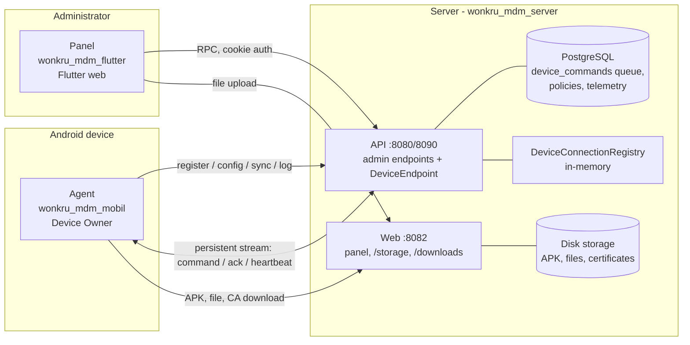

# Wonkru MDM

<picture>
  <source media="(prefers-color-scheme: dark)" srcset="wonkru_mdm_flutter/assets/images/wonkrumdm-logo-light.png">
  
</picture>

> English (default) · [Türkçe](README_TR.md)

[Documentation](https://docs.wonkrumdm.com) ·
[Application source](https://github.com/Aksoyhlc/wonkru_mdm)

An open-source Mobile Device Management (MDM) system for Android. The server and admin
panel are written in Dart, and the device agent uses Flutter and Kotlin. Wonkru MDM
manages devices enrolled with Android Enterprise Device Owner through a Flutter web
panel and a Serverpod server.

Wonkru MDM is built for teams that need to enroll, configure, monitor, and remotely
manage fleets of Android devices without depending on a closed SaaS service. It runs on
a single server, whether rented or owned.

## Features

- **Device enrollment:** QR-code provisioning enrolls a factory-reset device as a Device
  Owner.
- **Policies:** versioned packages of settings, restrictions, launcher configuration,
  applications, files, and certificates. The agent applies the latest policy offline and
  reconciles on reconnect.
- **Remote commands:** lock, reboot, clear app data, launch apps, send notifications,
  collect installed apps, location, and logs. Commands are stored in `device_commands`
  and sent over a persistent Serverpod stream when the device connects.
- **Telemetry:** full device sync (hardware, battery, network, security, installed
  apps, storage), heartbeat, event reports, and log collection.
- **Admin panel:** dashboard, device management, policy editor, application and
  certificate management, file storage, provisioning profiles, users, 2FA (TOTP +
  recovery codes), audit log, and TR/EN localization.
- **Alerts:** offline devices, pending policy updates, and security signals are routed
  to the panel and/or email.
- **File delivery:** APKs are stored on the public disk. Private files and certificates
  use HMAC-signed links that expire.

## Requirements

Run the Linux commands in a terminal on your Ubuntu or Debian server. The installer sets up
Docker from its official APT repository if Docker is missing. If you already have Docker,
you need Compose 2.24.4 or later. For a local installation on a Mac, start Docker Desktop.

## Quick start

Run Wonkru MDM on one server with the published Docker image. The installer starts the
admin panel, API, PostgreSQL, and Caddy. Ports, updates, and backups are in the
[installation guide](https://docs.wonkrumdm.com/deployment/self-hosting/).

> Until you create the first admin, anyone who can reach the API can register that account.
> Before running the installer, restrict access to both the API and panel to your IP address
> or trusted network. Docker can publish ports outside UFW's rules.

### Ubuntu or Debian with domains and HTTPS

Use this option when the panel and Android devices will connect over the internet. Replace
the example domains with two names that point to your server. Leave port 80 reachable so
Caddy can obtain certificates.

```bash
curl -fsSL https://wonkrumdm.com/install.sh | sudo bash -s -- \
  --api-host api.example.com \
  --panel-host app.example.com \
  --email ops@example.com
```

Open `https://app.example.com` with your actual panel domain. The installer prints that
address at the end.

### Ubuntu or Debian with an IP address and HTTP

Use HTTP on a trusted local network.

```bash
curl -fsSL https://wonkrumdm.com/install.sh | sudo bash
```

If the detected address is out of reach or the default ports are in use:

```bash
curl -fsSL https://wonkrumdm.com/install.sh | sudo bash -s -- \
  --host 192.168.1.20 --api-port 9080 --panel-port 9082
```

With these values, open `http://192.168.1.20:9082`. Devices connect to
`http://192.168.1.20:9080`.

### macOS

Start Docker Desktop and run the command in Terminal as your normal user.

```bash
curl -fsSL https://wonkrumdm.com/install.sh | bash -s -- \
  --dir "$HOME/wonkru-mdm"
```

Choose HTTP and accept the defaults. Open `http://localhost:8082`.

### Create the first admin

Open the panel address, create your admin account, and enable two-factor authentication.
Set the panel time zone under **Settings**.

### Recover an admin account

If the last admin forgets the password, or loses the authenticator app, reset it from the
server shell. The command talks to the database directly: it does not open the API and the
panel does not need to be reachable.

```bash
cd /opt/wonkru-mdm

# Password only
docker compose exec server ./bin/server admin passwd --email you@example.com

# The account is missing entirely
docker compose exec server ./bin/server admin passwd --email you@example.com --create

# The authenticator device is also lost
docker compose exec server ./bin/server admin passwd --email you@example.com --clear-totp

# List admins and their 2FA state
docker compose exec server ./bin/server admin list
```

The new password is prompted twice with echo disabled, so it stays out of the shell
history. For scripts, read it from stdin with `--password-stdin` and add `-T` to
`docker compose exec`. Existing sessions are revoked by default; `--keep-sessions` keeps
them. `--create`, `--grant-admin` and `--clear-totp` ask for confirmation, or accept
`--yes` in scripts. If the container is stopped, replace `exec` with
`run --rm --no-deps --entrypoint ./bin/server server`.

On macOS run the same commands from the directory you chose instead of
`/opt/wonkru-mdm`. This is the only way to clear 2FA when both the authenticator and the
recovery codes are lost; it requires shell access to the server, which already grants
full control, so only use it on a trusted machine.

### Find the Starter device admin password

The installer generates a unique password for the **Starter** policy's on-device IT page.

```bash
sudo grep '^STARTER_ADMIN_PASSWORD=' /opt/wonkru-mdm/.env
```

On macOS, run `grep` in the directory you chose. To change it later, edit
**Policies → Starter → General → Admin Password**. Details:
[Find the Starter device admin password](https://docs.wonkrumdm.com/deployment/self-hosting/#find-the-starter-device-admin-password).

### Enroll an Android device

The first installation includes the **Starter** policy, the signed Wonkru MDM app, and a
**Wonkru MDM** provisioning profile. From the dashboard, select **Download MDM APK**, or
open **Provisioning Profiles → Wonkru MDM** and scan that profile's QR code on a new or
factory-reset device. Wi-Fi and permissions:
[Enroll an Android device](https://docs.wonkrumdm.com/deployment/self-hosting/#enroll-an-android-device).

## Developers

The component diagram is also on the [architecture page](https://docs.wonkrumdm.com/getting-started/architecture/).
To build and run from source, follow the
[development setup guide](https://docs.wonkrumdm.com/getting-started/development-setup/).

### Architecture



| Component | Technology | Role |
|---|---|---|
| Server | Serverpod 4, PostgreSQL 16 | Auth, policies, command queue, telemetry, storage, alerts |
| Panel | Flutter web, GetX, go_router, shadcn_ui, Syncfusion DataGrid | Admin UI |
| Agent | Flutter + Kotlin, Android Device Owner | Applies policy, runs commands, reports telemetry, launcher |
| Core | Serverpod module | Shared enums, DTOs, and catalogs for all three sides |

**Design notes**

- The agent talks to the server over one persistent, typed Serverpod stream. Commands
  are written to the `device_commands` table first, so they survive restarts.
- Identity is per device: registration issues a random token, and only its SHA-256 is
  stored.
- The server runs as a **single instance**: the connection registry and rate limiter
  live in process memory. There is no Redis requirement for a single node.
- Devices pull policies; the server only signals that a new version exists.

### Repository layout

```
wonkru_mdm/
  wonkru_core_server/   Serverpod module: shared enums, DTOs, catalogs
  wonkru_core_client/   generated client for the module
  wonkru_mdm_server/    Serverpod backend
  wonkru_mdm_client/    generated server client (do not edit)
  wonkru_mdm_flutter/   Flutter web admin panel
  wonkru_mdm_mobil/     Android Device Owner agent (Flutter + Kotlin)
  deploy/vps/           single-VPS deployment (Docker Compose + Caddy)
```

### Requirements

- Dart SDK `^3.12.2`
- Flutter `^3.44.4`
- Serverpod CLI `4.1.2` (`dart install serverpod_cli 4.1.2`)
- Android SDK + `adb` (for the agent)
- Docker (only for production deployment; development and tests use an embedded
  PostgreSQL and need no Docker)

### Quick start (development)

See the [development setup guide](https://docs.wonkrumdm.com/getting-started/development-setup/)
for the full configuration reference.

Run the following commands from the repository root. The server, panel, core and
generated clients share a pub workspace; the Android agent has its own dependency
resolution.

```bash
dart install serverpod_cli 4.1.2
flutter pub get
dart run wonkru_mdm_server/tool/create_dev_passwords.dart
cd wonkru_mdm_server
serverpod start
```

The secrets command creates `config/passwords.yaml` with a `development:` block and
independent random values for `database`, `serviceSecret`, `emailSecretHashPepper`,
`jwtHmacSha512PrivateKey`, `jwtRefreshTokenHashPepper`, `passwordHashPepper`, and
`storageSigningKey`. It refuses to overwrite an existing file. Keep this file
private. These are development secrets; use `deploy/vps/init-env.sh` for deployment.

#### Prepare the panel before enrolling a device

1. Open `http://localhost:8099`, create the first admin and sign in. Enable 2FA in
   your profile. Complete first-admin setup before exposing the server publicly.
2. Open **Policies**, create a policy with a name and mark it as **Default policy**.
   Save it before enrolling the first device. Start with launcher mode disabled so
   the initial setup remains easy to complete.
3. Open **Settings → Device Enrollment Key**. Keep the key available for the agent's
   setup screen, or display its setup QR.

A newly registered device receives the default policy. Without one, registration
can create a device record but the agent cannot complete its setup.

#### Install the Android agent on an emulator

Use a fresh Android emulator with no Google or other accounts added. Device Owner
provisioning requires an unprovisioned/account-free device. From the repository
root, in another terminal:

```bash
cd wonkru_mdm_mobil
flutter pub get
flutter build apk --debug --dart-define-from-file=config.json --dart-define=HOST=10.0.2.2
adb devices -l
```

Replace `DEVICE_SERIAL` with the emulator serial listed by ADB:

```bash
adb -s DEVICE_SERIAL install -r build/app/outputs/flutter-apk/app-debug.apk
adb -s DEVICE_SERIAL shell dpm set-device-owner com.wonkrumdm/.core.receivers.MdmDeviceAdminReceiver
adb -s DEVICE_SERIAL shell am start -n com.wonkrumdm/.MainActivity
```

Complete the permissions screen, then use `http://10.0.2.2:8090` as the server
address and enter the panel's enrollment key. The emulator reaches the computer
through `10.0.2.2`; the development configuration already uses this address for
file downloads on port 8082.

The first device should appear in **Devices** with its default policy and a recent
sync. Change a harmless policy setting or send a notification, then check the
reported result in the panel. QR Device Owner provisioning is the field-install
alternative; it requires a factory-reset device and a provisioning profile with a
reachable APK URL and its signing checksum.

#### Use a physical Android device

Use a dedicated account-free device. In your local
`wonkru_mdm_server/config/development.yaml`, set `webServer.publicHost` to the
computer's LAN IP so that APK/file/certificate download URLs are reachable. Build
the agent with `--dart-define=HOST=YOUR_LAN_IP` and use
`http://YOUR_LAN_IP:8090` during setup. Allow ports 8090 and 8082 through the local
firewall. `localhost` and `10.0.2.2` do not refer to the development computer from a
physical phone. Keep the panel's development API URL and allowed origin unchanged
unless you also move the panel to another host.

### Deploy from this repository

The published image is installed with the quick start above. This checkout can also be
deployed with `deploy/vps/` on one Ubuntu or Debian server, using Docker Compose and Caddy.

The first installation includes a default policy, a provisioning profile, and the signed Android agent. Download it from the dashboard.

Generate the environment file from the repository root:

```bash
(cd deploy/vps && ./init-env.sh)
```

The generated `.env` uses single-host HTTP. For a public deployment, set the API and panel
domains, HTTPS schemes and ports, Caddy site addresses, `PANEL_ORIGIN`, `APP_URL`,
`AUTH_COOKIE_SECURE=true`, and `ACME_EMAIL` in `deploy/vps/.env`. Point both domains to the VPS.
Keep the generated secrets. Copy `.env` to `/opt/wonkru-mdm/deploy/vps/.env` on the VPS, then run:

```bash
./deploy/vps/deploy.sh root@<vps-ip>
```

## Security

Please do not open public issues for vulnerabilities. See [SECURITY.md](SECURITY.md).
Before publishing or deploying, never commit `config/passwords.yaml`, `deploy/vps/.env`,
or release keystores.

## Contributing

Contributions are welcome. See [CONTRIBUTING.md](CONTRIBUTING.md).

## License

Licensed under the [Apache License 2.0](LICENSE).
