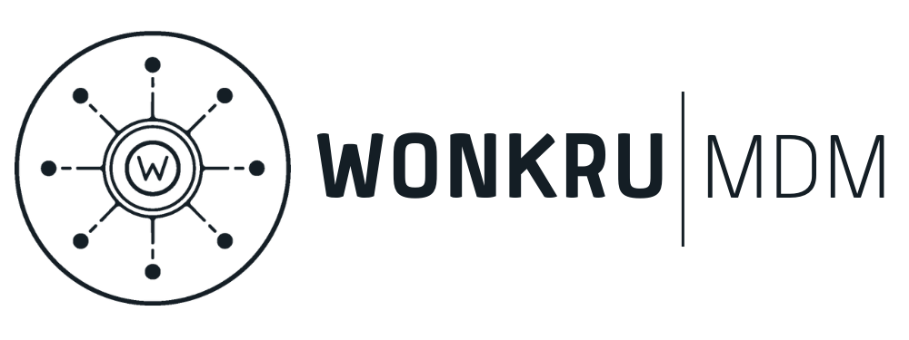
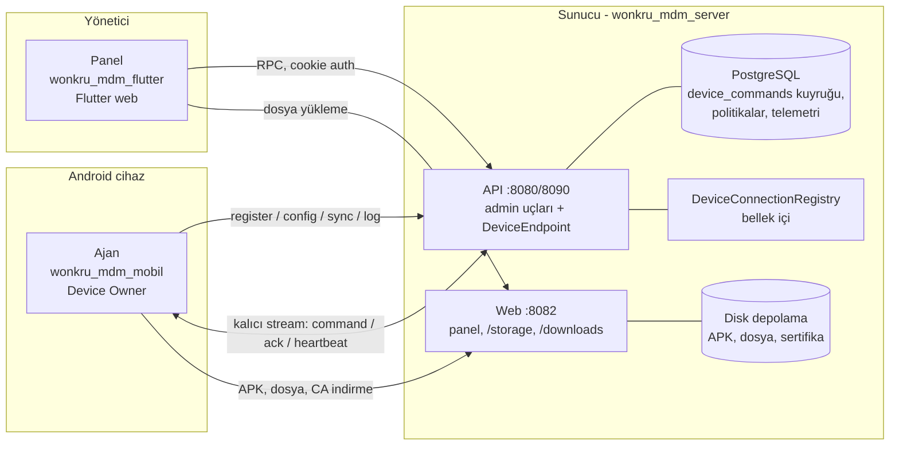

# Wonkru MDM

<picture>
  <source media="(prefers-color-scheme: dark)" srcset="wonkru_mdm_flutter/assets/images/wonkrumdm-logo-light.png">
  
</picture>

> [English](README.md) · Türkçe

[Dokümantasyon](https://docs.wonkrumdm.com/tr/) ·
[Uygulama kaynak kodu](https://github.com/Aksoyhlc/wonkru_mdm)

Android için açık kaynak bir Mobil Cihaz Yönetimi (MDM) sistemi. Sunucu ve yönetim paneli
Dart ile, cihaz ajanı ise Flutter ve Kotlin ile geliştirilmiştir. Wonkru MDM, Android
Enterprise kapsamında Device Owner olarak kaydedilen cihazları Flutter web yönetim paneli
ve Serverpod sunucusu üzerinden yönetir.

Wonkru MDM, kapalı bir SaaS hizmetine bağımlı olmadan Android cihaz filolarını kaydetmek,
yapılandırmak, izlemek ve uzaktan yönetmek isteyen ekipler için tasarlandı. Tek bir
sunucuda, kiralık veya kendi makinenizde çalışır.

## Özellikler

- **Cihaz kaydı:** QR kodla kurulum, fabrika ayarlarına sıfırlanmış cihazı Device Owner
  olarak kaydeder.
- **Politikalar:** ayar, kısıtlama, launcher yapılandırması, uygulama, dosya ve
  sertifika içeren sürümlü paketler. Ajan en güncel politikayı çevrimdışıyken de uygular
  ve sunucuya yeniden bağlandığında eşitler.
- **Uzak komutlar:** cihazı kilitleme veya yeniden başlatma, uygulama verisini temizleme,
  uygulama açma, bildirim gönderme, kurulu uygulamaları, konumu ve logları toplama.
  Komutlar `device_commands` tablosunda tutulur ve cihaz bağlandığında kalıcı
  Serverpod bağlantısı üzerinden gönderilir.
- **Telemetri:** cihaz bilgileri (donanım, pil, ağ, güvenlik, kurulu uygulamalar ve depolama),
  heartbeat, olay raporları ve log toplama.
- **Yönetim paneli:** gösterge paneli, cihaz yönetimi, politika düzenleyicisi, uygulama ve
  sertifika yönetimi, dosya depolama, QR ile kurulum profilleri, kullanıcılar, 2FA (TOTP +
  kurtarma kodları), denetim kaydı ve Türkçe/İngilizce dil desteği.
- **Uyarılar:** çevrimdışı cihazlar, bekleyen politika güncellemeleri ve güvenlik
  sinyalleri panelde gösterilir ve/veya e-postayla gönderilir.
- **Dosya dağıtımı:** APK'lar herkese açık depolama alanındadır. Özel dosyalar ve
  sertifikalar süreli, HMAC imzalı bağlantılarla indirilir.

## Gereksinimler

Linux komutlarını Ubuntu veya Debian sunucunuzda çalıştırın. Docker kurulu değilse betik
Docker'ın resmî APT deposundan kurar. Docker zaten kuruluysa Compose 2.24.4 veya üzeri gerekir.
Mac'te yerel kurulum için Docker Desktop'ı açın.

## Hızlı başlangıç

Wonkru MDM'i hazır Docker imajıyla tek bir sunucuya kurabilirsiniz. Kurulum betiği yönetim
panelini, API'yi, PostgreSQL'i ve Caddy'yi başlatır. Port, güncelleme ve yedekler
[kurulum kılavuzunda](https://docs.wonkrumdm.com/tr/deployment/self-hosting/).

> İlk yönetici hesabı açılana kadar API'ye erişebilen biri bu hesabı oluşturabilir. Komutu
> çalıştırmadan önce hem API hem panel erişimini kendi IP adresinizle veya güvendiğiniz ağla
> sınırlayın. Docker'ın açtığı portlar UFW kurallarını atlayabilir.

### Ubuntu veya Debian, alan adıyla HTTPS

Paneli veya Android cihaz bağlantılarını internete açacaksanız bu yöntemi kullanın. Örnekteki
iki alan adı yerine sunucunuza yönlenen kendi adreslerinizi yazın. Caddy'nin sertifika
alabilmesi için 80 portunu açık tutun.

```bash
curl -fsSL https://wonkrumdm.com/install.sh | sudo bash -s -- \
  --api-host api.example.com \
  --panel-host app.example.com \
  --email ops@example.com
```

`https://app.example.com` yerine kendi panel adresinizi açın. Betik kurulum sonunda bu
adresi gösterir.

### Ubuntu veya Debian, IP adresiyle HTTP

HTTP'yi güvendiğiniz bir yerel ağda kullanın.

```bash
curl -fsSL https://wonkrumdm.com/install.sh | sudo bash
```

Cihazlar algılanan adrese ulaşamıyorsa veya varsayılan portlar doluysa:

```bash
curl -fsSL https://wonkrumdm.com/install.sh | sudo bash -s -- \
  --host 192.168.1.20 --api-port 9080 --panel-port 9082
```

Bu örnekte tarayıcıdan `http://192.168.1.20:9082` adresini açın. Cihazlar API'ye
`http://192.168.1.20:9080` üzerinden bağlanır.

### macOS

Docker Desktop'ı açın. Terminalde komutu normal kullanıcınızla çalıştırın.

```bash
curl -fsSL https://wonkrumdm.com/install.sh | bash -s -- \
  --dir "$HOME/wonkru-mdm"
```

Yerel kurulum için HTTP'yi seçip varsayılan değerleri kabul edin. Paneli
`http://localhost:8082` adresinden açın.

### İlk yönetici hesabını açın

Paneli açın, yönetici hesabınızı oluşturun ve iki adımlı doğrulamayı etkinleştirin.
Panelin saat dilimini **Ayarlar** bölümünden seçin.

### Yönetici hesabını kurtarın

Son yönetici şifresini unutursa veya doğrulayıcı uygulamayı kaybederse, hesabı sunucu
kabuğundan sıfırlayın. Komut veritabanına doğrudan bağlanır: API açılmaz, panelin
erişilebilir olması gerekmez.

```bash
cd /opt/wonkru-mdm

# Yalnızca şifre
docker compose exec server ./bin/server admin passwd --email siz@example.com

# Hesap hiç yoksa
docker compose exec server ./bin/server admin passwd --email siz@example.com --create

# Doğrulayıcı cihaz da kaybolduysa
docker compose exec server ./bin/server admin passwd --email siz@example.com --clear-totp

# Yöneticileri ve 2FA durumlarını listele
docker compose exec server ./bin/server admin list
```

Yeni şifre, ekrana yazılmadan iki kez sorulur; böylece kabuk geçmişine düşmez. Betikler
için `--password-stdin` ile standart girdiden okuyun ve `docker compose exec` komutuna
`-T` ekleyin. Açık oturumlar varsayılan olarak iptal edilir; `--keep-sessions` korur.
`--create`, `--grant-admin` ve `--clear-totp` onay ister; betiklerde `--yes` verin.
Container durmuşsa `exec` yerine
`run --rm --no-deps --entrypoint ./bin/server server` kullanın.

macOS'ta `/opt/wonkru-mdm` yerine seçtiğiniz dizinden çalıştırın. Doğrulayıcı ve kurtarma
kodları birlikte kaybolduğunda 2FA'yı temizlemenin tek yolu budur; sunucuda kabuk erişimi
gerektirir ve bu erişim zaten tam kontrol demektir, yalnızca güvendiğiniz makinede
kullanın.

### Starter cihaz yönetici şifresini bulun

Kurulum betiği **Starter** politikasının cihazdaki IT ekranı için her kurulumda ayrı bir
şifre üretir.

```bash
sudo grep '^STARTER_ADMIN_PASSWORD=' /opt/wonkru-mdm/.env
```

macOS'ta `grep` komutunu kendi kurulum dizininizin yoluyla çalıştırın. Şifreyi sonradan
değiştirmek için panelde **Politikalar → Starter → Genel → Yönetici Şifresi** alanını
düzenleyin. Ayrıntı:
[Starter cihaz yönetici şifresini bulun](https://docs.wonkrumdm.com/tr/deployment/self-hosting/#starter-cihaz-yönetici-şifresini-bulun).

### Android cihaz ekleyin

İlk kurulumda **Starter** politikası, imzalı Wonkru MDM uygulaması ve **Wonkru MDM**
provizyon profili hazır gelir. Ana sayfada **MDM APK’yı indir** düğmesine basın veya
**Provizyon Profilleri → Wonkru MDM** profilinin QR kodunu yeni ya da fabrika ayarlarına
dönmüş cihazda okutun. Wi-Fi ve izinler:
[Android cihaz ekleyin](https://docs.wonkrumdm.com/tr/deployment/self-hosting/#android-cihaz-ekleyin).

## Geliştiriciler

Bileşen şeması [mimari sayfasında](https://docs.wonkrumdm.com/tr/getting-started/architecture/) da vardır.
Kaynak koddan derleyip çalıştırmak için
[geliştirme ortamı rehberini](https://docs.wonkrumdm.com/tr/getting-started/development-setup/) izleyin.

### Mimari



| Bileşen | Teknoloji | Görev |
|---|---|---|
| Sunucu | Serverpod 4, PostgreSQL 16 | Kimlik, politika, komut kuyruğu, telemetri, depolama, uyarılar |
| Panel | Flutter web, GetX, go_router, shadcn_ui, Syncfusion DataGrid | Yönetici arayüzü |
| Ajan | Flutter + Kotlin, Android Device Owner | Politikayı uygular, komutları çalıştırır, cihaz bilgilerini gönderir ve başlatıcıyı yönetir |
| Core | Serverpod modülü | Üç tarafın ortak enum, DTO ve katalogları |

**Tasarım notları**

- Ajan sunucuyla tek bir kalıcı, tipli Serverpod stream'i üzerinden konuşur. Komutlar
  önce `device_commands` tablosuna yazılır, böylece yeniden başlatmaya dayanır.
- Kimlik cihaz başınadır: kayıt rastgele bir token üretir ve yalnızca SHA-256'sı saklanır.
- Sunucu **tek örnek** olarak çalışır: bağlantı kaydı ve istek sınırları süreç belleğindedir.
  Tek sunucu için Redis gerekmez.
- Cihazlar politikayı çeker; sunucu yalnızca yeni bir sürüm olduğunu bildirir.

### Depo yapısı

```
wonkru_mdm/
  wonkru_core_server/   Serverpod modülü: ortak enum, DTO, katalog
  wonkru_core_client/   modülün üretilen istemcisi
  wonkru_mdm_server/    Serverpod arka ucu
  wonkru_mdm_client/    üretilen sunucu istemcisi (elle düzenlenmez)
  wonkru_mdm_flutter/   Flutter web yönetim paneli
  wonkru_mdm_mobil/     Android Device Owner ajanı (Flutter + Kotlin)
  deploy/vps/           tek VPS kurulumu (Docker Compose + Caddy)
```

### Gereksinimler

- Dart SDK `^3.12.2`
- Flutter `^3.44.4`
- Serverpod CLI `4.1.2` (`dart install serverpod_cli 4.1.2`)
- Android SDK + `adb` (ajan için)
- Docker (yalnızca üretim dağıtımı için; geliştirme ve testler gömülü PostgreSQL
  kullanır, Docker gerekmez)

### Hızlı başlangıç (geliştirme)

Yapılandırma ayrıntıları için [geliştirme ortamı rehberine](https://docs.wonkrumdm.com/tr/getting-started/development-setup/)
bakın.

Aşağıdaki komutları depo kökünden çalıştırın. Sunucu, panel, core ve üretilen
istemciler tek bir pub workspace kullanır; Android ajanının bağımlılıkları ayrı
çözülür.

```bash
dart install serverpod_cli 4.1.2
flutter pub get
dart run wonkru_mdm_server/tool/create_dev_passwords.dart
cd wonkru_mdm_server
serverpod start
```

Sır oluşturma komutu, `config/passwords.yaml` dosyasına `development:` bloğunu ve
`database`, `serviceSecret`, `emailSecretHashPepper`, `jwtHmacSha512PrivateKey`,
`jwtRefreshTokenHashPepper`, `passwordHashPepper`, `storageSigningKey` için ayrı
rastgele değerleri yazar. Mevcut dosyayı ezmez. Bu dosyayı gizli tutun. Bunlar
geliştirme sırlarıdır; dağıtım için `deploy/vps/init-env.sh` kullanın.

#### Cihaz kaydından önce paneli hazırlayın

1. `http://localhost:8099` adresini açın, ilk yöneticiyi oluşturun ve giriş yapın.
   Profilinizde 2FA'yı etkinleştirin. Sunucuyu herkese açmadan önce ilk yönetici
   kurulumunu tamamlayın.
2. **Politikalar** bölümünde adı olan bir politika oluşturun, **Varsayılan politika**
   olarak işaretleyip kaydedin. İlk kurulumda launcher modunu kapalı tutmak
   cihazdaki kurulum adımlarını tamamlamayı kolaylaştırır.
3. **Ayarlar → Cihaz Kayıt Anahtarı** bölümünden anahtarı alın veya kurulum QR'ını
   gösterin; bu değer ajanın kurulum ekranında kullanılacak.

Yeni kaydedilen cihaz varsayılan politikayı alır. Varsayılan politika yoksa
sunucuda cihaz kaydı oluşabilir fakat ajan kurulumunu tamamlayamaz.

#### Android ajanını emülatöre kurun

Google veya başka bir hesap eklenmemiş yeni bir Android emülatörü kullanın.
Device Owner kurulumu için cihazın henüz yapılandırılmamış/hesapsız olması gerekir.
Başka bir terminalde depo kökünden başlayın:

```bash
cd wonkru_mdm_mobil
flutter pub get
flutter build apk --debug --dart-define-from-file=config.json --dart-define=HOST=10.0.2.2
adb devices -l
```

`DEVICE_SERIAL` yerine ADB listesindeki emülatör seri numarasını yazın:

```bash
adb -s DEVICE_SERIAL install -r build/app/outputs/flutter-apk/app-debug.apk
adb -s DEVICE_SERIAL shell dpm set-device-owner com.wonkrumdm/.core.receivers.MdmDeviceAdminReceiver
adb -s DEVICE_SERIAL shell am start -n com.wonkrumdm/.MainActivity
```

İzin ekranını tamamlayın. Kurulum ekranında sunucu adresini
`http://10.0.2.2:8090` olarak girin ve panelden aldığınız kayıt anahtarını kullanın.
Emülatör bilgisayara `10.0.2.2` üzerinden ulaşır; geliştirme yapılandırması 8082
portundaki dosya indirmeleri için de bu adresi kullanır.

İlk cihaz **Cihazlar** bölümünde varsayılan politikası ve güncel senkron bilgisiyle
görünmelidir. Zararsız bir politika ayarını değiştirin veya bildirim gönderip
raporlanan sonucu panelde kontrol edin. Sahada alternatif kurulum QR Device Owner
provisioning'dir; fabrika ayarlarına sıfırlanmış cihaz, erişilebilir APK adresi ve
APK'nın imza checksum'ını içeren bir provisioning profili gerektirir.

#### Fiziksel Android cihaz kullanın

Bu iş için ayrılmış, hesap eklenmemiş bir cihaz kullanın. Yerel
`wonkru_mdm_server/config/development.yaml` dosyanızda `webServer.publicHost`
değerini bilgisayarın LAN IP'sine ayarlayın; böylece APK/dosya/sertifika adreslerine
telefondan ulaşılabilir. Ajanı `--dart-define=HOST=YOUR_LAN_IP` ile derleyin ve
kurulumda `http://YOUR_LAN_IP:8090` adresini kullanın. Güvenlik duvarında 8090 ve
8082 portlarına yerel ağ erişimi verin. Fiziksel telefonda `localhost` ve
`10.0.2.2` geliştirme bilgisayarını göstermez. Paneli başka bir host'a taşımıyorsanız
panelin geliştirme API adresini ve izin verilen origin değerini koruyun.

### Kaynak depodan dağıtım

Hazır imaj yukarıdaki hızlı başlangıçla kurulur. Bu depo ayrıca `deploy/vps/` ile tek bir
Ubuntu veya Debian sunucusuna, Docker Compose ve Caddy kullanarak dağıtılabilir.

İlk kurulumda varsayılan politika, provizyon profili ve imzalı Android ajanı hazır gelir. APK’yı panelin ana sayfasından indirebilirsiniz.

Depo kökünden ortam dosyasını oluşturun:

```bash
(cd deploy/vps && ./init-env.sh)
```

Üretilen `.env` tek host ve HTTP kullanır. Herkese açık dağıtım için
`deploy/vps/.env` içinde API ve panel alan adlarını, HTTPS şemalarını ve portlarını,
Caddy site adreslerini, `PANEL_ORIGIN`, `APP_URL`, `AUTH_COOKIE_SECURE=true` ve
`ACME_EMAIL` değerlerini ayarlayın. İki alan adını da VPS'e yönlendirin. Üretilen sırları
koruyun. `.env` dosyasını VPS'te `/opt/wonkru-mdm/deploy/vps/.env` konumuna kopyalayıp
depo kökünden çalıştırın:

```bash
./deploy/vps/deploy.sh root@<vps-ip>
```

## Güvenlik

Güvenlik açıklarını GitHub'da herkese açık bir issue olarak bildirmeyin. Bkz.
[SECURITY_TR.md](SECURITY_TR.md).
Yayımlamadan veya dağıtıma almadan önce `config/passwords.yaml`, `deploy/vps/.env` veya
sürüm imzalama anahtarlarını asla commit'lemeyin.

## Katkı

Katkılar memnuniyetle karşılanır. Bkz. [CONTRIBUTING.md](CONTRIBUTING.md).

## Lisans

[Apache License 2.0](LICENSE) altında lisanslanmıştır.
